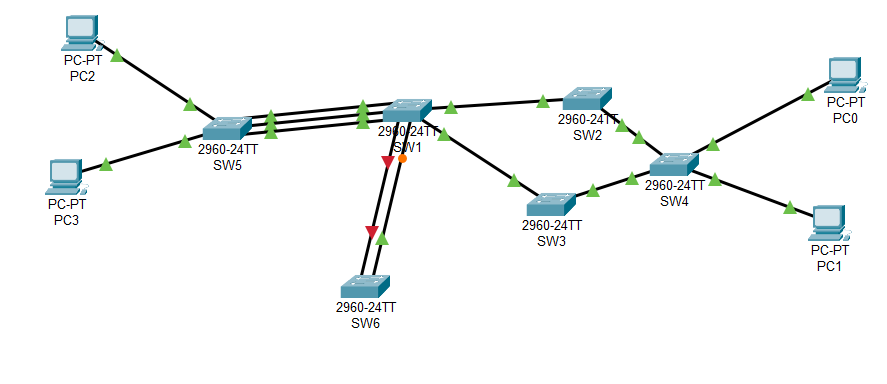

# Отчет по лабораторной работе №4
**Тема:** Spanning Tree Protocol
**Выполнил:** Мазов С. М., гр. 409  

## Топология



## Ответы на вопросы

1. Вывод команды show spanning-tree на SW1:
```
VLAN0001
  Spanning tree enabled protocol ieee
  Root ID    Priority    32769
             Address     0000.0CDD.9124
             Cost        4
             Port        26(GigabitEthernet0/2)
             Hello Time  2 sec  Max Age 20 sec  Forward Delay 15 sec

  Bridge ID  Priority    32769  (priority 32768 sys-id-ext 1)
             Address     0001.9795.CE93
             Hello Time  2 sec  Max Age 20 sec  Forward Delay 15 sec
             Aging Time  20

Interface        Role Sts Cost      Prio.Nbr Type
---------------- ---- --- --------- -------- --------------------------------
Fa0/3            Desg FWD 19        128.3    P2p
Gi0/1            Desg FWD 4         128.25   P2p
Gi0/2            Root FWD 4         128.26   P2p
Fa0/2            Desg FWD 19        128.2    P2p
Fa0/1            Desg FWD 19        128.1    P2p
```
Вывод команды show spanning-tree на SW2:
```
VLAN0001
  Spanning tree enabled protocol ieee
  Root ID    Priority    32769
             Address     0000.0CDD.9124
             Cost        8
             Port        25(GigabitEthernet0/1)
             Hello Time  2 sec  Max Age 20 sec  Forward Delay 15 sec

  Bridge ID  Priority    32769  (priority 32768 sys-id-ext 1)
             Address     00E0.F922.CB47
             Hello Time  2 sec  Max Age 20 sec  Forward Delay 15 sec
             Aging Time  20

Interface        Role Sts Cost      Prio.Nbr Type
---------------- ---- --- --------- -------- --------------------------------
Gi0/1            Root FWD 4         128.25   P2p
Gi0/2            Altn BLK 4         128.26   P2p
```
Вывод команды show spanning-tree на SW3:
```
VLAN0001
  Spanning tree enabled protocol ieee
  Root ID    Priority    32769
             Address     0000.0CDD.9124
             This bridge is the root
             Hello Time  2 sec  Max Age 20 sec  Forward Delay 15 sec

  Bridge ID  Priority    32769  (priority 32768 sys-id-ext 1)
             Address     0000.0CDD.9124
             Hello Time  2 sec  Max Age 20 sec  Forward Delay 15 sec
             Aging Time  20

Interface        Role Sts Cost      Prio.Nbr Type
---------------- ---- --- --------- -------- --------------------------------
Gi0/2            Desg FWD 4         128.26   P2p
Gi0/1            Desg FWD 4         128.25   P2p
```
Вывод команды show spanning-tree на SW4:
```
VLAN0001
  Spanning tree enabled protocol ieee
  Root ID    Priority    32769
             Address     0000.0CDD.9124
             Cost        4
             Port        26(GigabitEthernet0/2)
             Hello Time  2 sec  Max Age 20 sec  Forward Delay 15 sec

  Bridge ID  Priority    32769  (priority 32768 sys-id-ext 1)
             Address     0006.2A65.5018
             Hello Time  2 sec  Max Age 20 sec  Forward Delay 15 sec
             Aging Time  20

Interface        Role Sts Cost      Prio.Nbr Type
---------------- ---- --- --------- -------- --------------------------------
Fa0/11           Desg FWD 19        128.11   P2p
Fa0/10           Desg FWD 19        128.10   P2p
Gi0/1            Desg FWD 4         128.25   P2p
Gi0/2            Root FWD 4         128.26   P2p
```
Вывод команды show spanning-tree на SW5:
```
VLAN0001
  Spanning tree enabled protocol ieee
  Root ID    Priority    32769
             Address     0000.0CDD.9124
             Cost        23
             Port        1(FastEthernet0/1)
             Hello Time  2 sec  Max Age 20 sec  Forward Delay 15 sec

  Bridge ID  Priority    32769  (priority 32768 sys-id-ext 1)
             Address     00E0.A300.5559
             Hello Time  2 sec  Max Age 20 sec  Forward Delay 15 sec
             Aging Time  20

Interface        Role Sts Cost      Prio.Nbr Type
---------------- ---- --- --------- -------- --------------------------------
Fa0/2            Altn BLK 19        128.2    P2p
Fa0/1            Root FWD 19        128.1    P2p
Fa0/3            Altn BLK 19        128.3    P2p
Fa0/10           Desg FWD 19        128.10   P2p
Fa0/11           Desg FWD 19        128.11   P2p
```
Корнем топологии выбран SW3.

Заблокированные порты у SW2 (Gi0/2) и у SW5 (Fa0/2 и Fa0/3). У всех интерфейсов роль - Altn, состояние - BLK.

2. Вывод команды show spanning-tree summary на SW3:
```
Switch is in pvst mode
Root bridge for: default
Extended system ID           is enabled
Portfast Default             is disabled
PortFast BPDU Guard Default  is disabled
Portfast BPDU Filter Default is disabled
Loopguard Default            is disabled
EtherChannel misconfig guard is disabled
UplinkFast                   is disabled
BackboneFast                 is disabled
Configured Pathcost method used is short

Name                   Blocking Listening Learning Forwarding STP Active
---------------------- -------- --------- -------- ---------- ----------
VLAN0001                     0         0        0          2          2

---------------------- -------- --------- -------- ---------- ----------
1 vlans                      0         0        0          2          2
```
Протокол STP работает в режиме pvst.

3. Вывод команды show spanning-tree summary на SW3:
```
Switch is in rapid-pvst mode
Root bridge for: default
Extended system ID           is enabled
Portfast Default             is disabled
PortFast BPDU Guard Default  is disabled
Portfast BPDU Filter Default is disabled
Loopguard Default            is disabled
EtherChannel misconfig guard is disabled
UplinkFast                   is disabled
BackboneFast                 is disabled
Configured Pathcost method used is short

Name                   Blocking Listening Learning Forwarding STP Active
---------------------- -------- --------- -------- ---------- ----------
VLAN0001                     0         0        0          2          2

---------------------- -------- --------- -------- ---------- ----------
1 vlans                      0         0        0          2          2
```
Теперь протокол STP работает в режиме rapid-pvst.

4.  Вывод команды show spanning-tree vlan 1 на SW1:
```
VLAN0001
  Spanning tree enabled protocol rstp
  Root ID    Priority    16385
             Address     0001.9795.CE93
             This bridge is the root
             Hello Time  2 sec  Max Age 20 sec  Forward Delay 15 sec

  Bridge ID  Priority    16385  (priority 16384 sys-id-ext 1)
             Address     0001.9795.CE93
             Hello Time  2 sec  Max Age 20 sec  Forward Delay 15 sec
             Aging Time  20

Interface        Role Sts Cost      Prio.Nbr Type
---------------- ---- --- --------- -------- --------------------------------
Fa0/3            Desg FWD 19        128.3    P2p
Gi0/1            Desg FWD 4         128.25   P2p
Gi0/2            Desg FWD 4         128.26   P2p
Fa0/2            Desg FWD 19        128.2    P2p
Fa0/1            Desg FWD 19        128.1    P2p
```
Вывод команды show spanning-tree vlan 10 на SW2:
```
VLAN0010
  Spanning tree enabled protocol rstp
  Root ID    Priority    16394
             Address     00E0.F922.CB47
             This bridge is the root
             Hello Time  2 sec  Max Age 20 sec  Forward Delay 15 sec

  Bridge ID  Priority    16394  (priority 16384 sys-id-ext 10)
             Address     00E0.F922.CB47
             Hello Time  2 sec  Max Age 20 sec  Forward Delay 15 sec
             Aging Time  20

Interface        Role Sts Cost      Prio.Nbr Type
---------------- ---- --- --------- -------- --------------------------------
Gi0/1            Desg FWD 4         128.25   P2p
Gi0/2            Desg FWD 4         128.26   P2p
```
Вывод команды show spanning-tree vlan 20 на SW3:
```
VLAN0020
  Spanning tree enabled protocol rstp
  Root ID    Priority    16404
             Address     0000.0CDD.9124
             This bridge is the root
             Hello Time  2 sec  Max Age 20 sec  Forward Delay 15 sec

  Bridge ID  Priority    16404  (priority 16384 sys-id-ext 20)
             Address     0000.0CDD.9124
             Hello Time  2 sec  Max Age 20 sec  Forward Delay 15 sec
             Aging Time  20

Interface        Role Sts Cost      Prio.Nbr Type
---------------- ---- --- --------- -------- --------------------------------
Gi0/2            Desg FWD 4         128.26   P2p
Gi0/1            Desg FWD 4         128.25   P2p
```
5. На SW5 корневым портом выбран Fa0/1.
Когда коммутатор получает несколько BPDU с равной стоимостью пути и от одного и того же соседа, он выбирает порт по наименьшему идентификатору порта отправителя, который складывается из приоритета порта и его физического номера на соседнем коммутаторе.

6. Вывод команды show spanning-tree на SW5:
```
VLAN0001
  Spanning tree enabled protocol rstp
  Root ID    Priority    16385
             Address     0001.9795.CE93
             Cost        19
             Port        1(FastEthernet0/1)
             Hello Time  2 sec  Max Age 20 sec  Forward Delay 15 sec

  Bridge ID  Priority    32769  (priority 32768 sys-id-ext 1)
             Address     00E0.A300.5559
             Hello Time  2 sec  Max Age 20 sec  Forward Delay 15 sec
             Aging Time  20

Interface        Role Sts Cost      Prio.Nbr Type
---------------- ---- --- --------- -------- --------------------------------
Fa0/2            Altn BLK 19        128.2    P2p
Fa0/1            Root FWD 19        128.1    P2p
Fa0/3            Altn BLK 19        128.3    P2p

VLAN0010
  Spanning tree enabled protocol rstp
  Root ID    Priority    16394
             Address     00E0.F922.CB47
             Cost        23
             Port        2(FastEthernet0/2)
             Hello Time  2 sec  Max Age 20 sec  Forward Delay 15 sec

  Bridge ID  Priority    32778  (priority 32768 sys-id-ext 10)
             Address     00E0.A300.5559
             Hello Time  2 sec  Max Age 20 sec  Forward Delay 15 sec
             Aging Time  20

Interface        Role Sts Cost      Prio.Nbr Type
---------------- ---- --- --------- -------- --------------------------------
Fa0/2            Root FWD 19        128.2    P2p
Fa0/1            Altn BLK 19        128.1    P2p
Fa0/3            Altn BLK 19        128.3    P2p
Fa0/10           Desg FWD 19        128.10   P2p

VLAN0020
  Spanning tree enabled protocol rstp
  Root ID    Priority    16404
             Address     0000.0CDD.9124
             Cost        14
             Port        3(FastEthernet0/3)
             Hello Time  2 sec  Max Age 20 sec  Forward Delay 15 sec

  Bridge ID  Priority    32788  (priority 32768 sys-id-ext 20)
             Address     00E0.A300.5559
             Hello Time  2 sec  Max Age 20 sec  Forward Delay 15 sec
             Aging Time  20

Interface        Role Sts Cost      Prio.Nbr Type
---------------- ---- --- --------- -------- --------------------------------
Fa0/2            Altn BLK 19        128.2    P2p
Fa0/1            Altn BLK 19        128.1    P2p
Fa0/3            Root FWD 10        128.3    P2p
Fa0/11           Desg FWD 19        128.11   P2p
```
Для VLAN 1 корневой порт - fa0/1, для VLAN 10 - fa0/2, для VLAN 20 - fa0/3.
Пинг проходит успешно.

7. Чтобы перевести магистральный интерфейс в режим PortFast, используется команда spanning-tree portfast trunk в режиме настройки интерфейса.
Так можно делать при подключении конечных устройств, поддерживающих тегирование VLAN (например, серверов с гипервизорами, точек доступа Wi-Fi или маршрутизаторов с сабинтерфейсами в схеме «Router-on-a-Stick»), но нельзя при подключении к другим коммутаторам, т.к. мгновенный переход порта
в состояние пересылки в обход этапов прослушивания и обучения может привести к образованию временных или постоянных петель коммутации.

8. Вывод команды show interface Fa0/4 на коммутаторе SW1:
```
FastEthernet0/4 is down, line protocol is down (err-disabled)
  Hardware is Lance, address is 0030.a342.6504 (bia 0030.a342.6504)
 BW 100000 Kbit, DLY 1000 usec,
     reliability 255/255, txload 1/255, rxload 1/255
  Encapsulation ARPA, loopback not set
  Keepalive set (10 sec)
  Full-duplex, 100Mb/s
  input flow-control is off, output flow-control is off
  ARP type: ARPA, ARP Timeout 04:00:00
  Last input 00:00:08, output 00:00:05, output hang never
  Last clearing of "show interface" counters never
  Input queue: 0/75/0/0 (size/max/drops/flushes); Total output drops: 0
  Queueing strategy: fifo
  Output queue :0/40 (size/max)
  5 minute input rate 0 bits/sec, 0 packets/sec
  5 minute output rate 0 bits/sec, 0 packets/sec
     956 packets input, 193351 bytes, 0 no buffer
     Received 956 broadcasts, 0 runts, 0 giants, 0 throttles
     0 input errors, 0 CRC, 0 frame, 0 overrun, 0 ignored, 0 abort
     0 watchdog, 0 multicast, 0 pause input
     0 input packets with dribble condition detected
     2357 packets output, 263570 bytes, 0 underruns
     0 output errors, 0 collisions, 10 interface resets
     0 babbles, 0 late collision, 0 deferred
     0 lost carrier, 0 no carrier
     0 output buffer failures, 0 output buffers swapped out
```
Интерфейс FastEthernet0/4 находится в состоянии аварийного отключёния. К этому состоянию привело получение служебного STP-кадра (BPDU) 
от подключённого коммутатора SW6: поскольку на порту Fa0/4 была включена защита BPDU Guard, 
коммутатор SW1 расценил появление сетевого оборудования как угрозу образования петли коммутации 
и автоматически заблокировал интерфейс.

9. Вывод команды show spanning-tree inconsistentports на SW1:
```
Name                 Interface            Inconsistency
-------------------- -------------------- ------------------
VLAN0001             FastEthernet0/5      Root Inconsistent

Number of inconsistent ports (segments) in the system : 1
```
В выводе команды отображается интерфейс FastEthernet0/5 в состоянии Root Inconsistent. 
К этому состоянию привело получение через порт Fa0/5 более выгодного кадра BPDU от 
подключённого коммутатора SW6 с меньшим приоритетом, поскольку на порту была активирована защита Root Guard, 
коммутатор SW1 заблокировал пересылку трафика через этот интерфейс, чтобы предотвратить 
несанкционированный перехват роли корневого коммутатора и сохранить заданную топологию STP.
